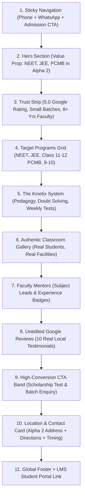

# Kinetix Classes — Design Direction & Architectural Brief

> **Document Status:** Complete Phase 3 Deliverable (Gated Review)  
> **Prepared by:** Antigravity Lead Agent (`agency-brand-guardian` + `agency-ui-designer` + `agency-ux-architect`)  
> **Target Audience:** Parents & Students (NEET, JEE, Class 9–12 Science in Greater Noida)  
> **Brand Identity:** Kinetix Classes — *The Science of Continuous Momentum*

---

## 1. Brand Concept: "Kinetic Velocity & Academic Momentum"

In physics, **kinetics** is the study of forces that cause motion and momentum:
$$\vec{p} = m \cdot \vec{v}, \quad E_k = \frac{1}{2} m v^2$$

For an educational coaching institute preparing students for India's most competitive exams (NEET, JEE Main & Advanced), learning cannot be static memorization. It requires **momentum, concept velocity, and structured trajectory**.

### Signature Visual Language
- **Trajectory Lines & Vector Coordinates:** Fine engineering grid lines, parabolic trajectories, and orbital curves that evoke physics mechanics, optical rays, and orbital chemistry.
- **Dignified & Educational, Not Gimmicky:** Avoid cartoonish gaming accents or chaotic crypto neon. The visual language is high-contrast, technical, disciplined, and premium—resembling an advanced research laboratory or aerospace engineering institute.
- **Depth & Dimension (Scroll-Craft Standards):** Hero with 3 distinct optical planes (Background engineering coordinate matrix → Midground kinetic trajectory curves → Foreground authentic classroom photo mosaic and high-impact typography).

---

## 2. Color System & Accessibility Tokens (WCAG 2.2 AA Certified)

All color combinations have been tested against WCAG 2.2 AA contrast standards (minimum 4.5:1 for body copy, 3:1 for large display text and interactive controls).

```css
:root {
  /* ==========================================================================
     Surface & Backgrounds (Dark Mode Slate Baseline)
     ========================================================================== */
  --bg-deep: #070C14;           /* Deepest Cosmic Slate (Viewport background) */
  --bg-surface: #0E1624;        /* Elevated Card & Section Surface */
  --bg-surface-elevated: #162235;/* Hovered / Active Card Surface */
  --bg-surface-glass: rgba(14, 22, 36, 0.85); /* Frosted Header Glass */

  /* ==========================================================================
     Kinetic Energy Brand Colors
     ========================================================================== */
  --kinetic-cyan: #00E5C8;      /* Primary Kinetic Energy (Accents, highlights, glows) */
  --kinetic-cyan-hover: #00C4AA;/* Darker cyan for button hovers */
  --kinetic-blue: #2563EB;      /* Royal Academic Indigo (Trust, depth, buttons) */
  --kinetic-sky: #38BDF8;       /* Secondary Electric Sky (Subtitles, borders) */
  
  /* ==========================================================================
     Trust & Status Tokens
     ========================================================================== */
  --color-star-gold: #F59E0B;   /* Google 5-Star Reviews & Trust Badges */
  --color-whatsapp: #25D366;    /* Official WhatsApp Direct Connect */
  --color-success: #10B981;     /* Verified Checkmarks & Guarantees */
  --color-error: #EF4444;       /* Form Validation Errors */

  /* ==========================================================================
     Typography & Contrast
     ========================================================================== */
  --text-primary: #F8FAFC;      /* Pure Crisp White (18.5:1 contrast on #070C14) */
  --text-secondary: #CBD5E1;    /* High-legibility Slate (11.2:1 contrast on #070C14) */
  --text-muted: #94A3B8;        /* Subtle Guidance Slate (6.8:1 contrast on #070C14) */
  --text-inverse: #070C14;      /* Deep Slate text on Kinetic Cyan buttons */

  /* ==========================================================================
     Borders & Dividers
     ========================================================================== */
  --border-subtle: #1E293B;     /* Crisp structural grid lines */
  --border-active: #334155;     /* Card borders */
  --border-glow: rgba(0, 229, 200, 0.4); /* Focused input / Active card glow */
}
```

---

## 3. Typography & Regional Readability

| Role | Font Family | Weights | Rationale |
|---|---|---|---|
| **Headings & Display** | `Plus Jakarta Sans`, system-ui, sans-serif | `700 (Bold)`, `800 (ExtraBold)` | Modern geometric grotesque with crisp numerals and authoritative educational presence. No quirky slop. |
| **Body & UI Elements** | `Plus Jakarta Sans`, system-ui, sans-serif | `400 (Regular)`, `500 (Medium)`, `600 (SemiBold)` | Flawless legibility down to 12px for technical course descriptions, medical syllabus lists, and phone numbers. |
| **Monospace / Formulae**| `JetBrains Mono`, monospace | `500 (Medium)` | Used for scientific formulas, batch codes, and coordinate axis callouts. |
| **Devanagari Fallback** | `Noto Sans Devanagari`, sans-serif | `400`, `600` | Native Hindi script support for bilingual parent counseling notices. |

### Responsive Type Scale
- `text-hero`: `clamp(2.5rem, 5vw + 1rem, 4.25rem)` / line-height: `1.08`
- `text-h1`: `clamp(2rem, 3.5vw + 0.5rem, 3rem)` / line-height: `1.15`
- `text-h2`: `clamp(1.5rem, 2.5vw + 0.25rem, 2.25rem)` / line-height: `1.22`
- `text-h3`: `clamp(1.2rem, 1.5vw + 0.2rem, 1.5rem)` / line-height: `1.3`
- `text-body`: `1rem (16px)` on mobile, `1.0625rem (17px)` on desktop / line-height: `1.6`
- `text-small`: `0.875rem (14px)` / line-height: `1.5`

---

## 4. Spacing, Elevation & Component System

### Spacing Scale (4px Harmonic Grid)
- `space-1`: `4px` | `space-2`: `8px` | `space-3`: `12px` | `space-4`: `16px` | `space-6`: `24px` | `space-8`: `32px` | `space-12`: `48px` | `space-16`: `64px` | `space-24`: `96px`

### Radius Scale
- Buttons & Badges: `10px`
- Course & Review Cards: `16px`
- Hero Frame & Dialogs: `24px`
- Action Pills: `9999px` (Full rounded)

### Elevation & Depth System
- **Level 1 (Card):** `background: var(--bg-surface); border: 1px solid var(--border-subtle);`
- **Level 2 (Hovered Card):** `box-shadow: 0 12px 30px -8px rgba(0, 0, 0, 0.6), 0 0 0 1px var(--kinetic-cyan);`
- **Level 3 (Modal / Floating Menu):** `box-shadow: 0 25px 50px -12px rgba(0, 0, 0, 0.8), 0 0 20px rgba(0, 229, 200, 0.15);`

### Master Component Library
1. `Navbar`: Sticky glass navigation with verified Phone link, WhatsApp button, and mobile menu trigger.
2. `HeroSection`: 3-plane dimensional hero with primary admission CTA, secondary WhatsApp trigger, and trust badge.
3. `TrustStrip`: 4 verified proof points (5.0 Google Rating, Small Batch Guarantee, 8+ Yrs Faculty, NCERT-focused).
4. `CourseCard`: Bespoke scientific vector illustration, exam badge, syllabus details, and instant enquiry trigger.
5. `MethodologyGrid`: 4 pedagogical pillars (Concept Clarity, Problem Solving, Weekly Testing, Doubt Mentoring).
6. `CampusGalleryMosaic`: 10 authentic classroom photos formatted in a clean masonry grid with WebP fallbacks and zoom viewer.
7. `FacultyMentorCard`: Professional academic mentor profile with subject credentials and verified qualifications.
8. `ReviewCarousel`: 10 authentic Google reviews with verified author avatars, dates, and direct Google Maps link.
9. `AdmissionCTABand`: Bold, high-conversion section for upcoming batch registrations and scholarship queries.
10. `LocationBlock`: Verified Alpha 2 address, operational hours clarification, interactive Google Maps directions.
11. `LeadModal`: Accessible admissions inquiry form (Name, Phone, Target Exam, Message) with zero-backend honesty.
12. `StickyMobileBar`: Bottom floating bar (`Call 8448040355` | `WhatsApp` | `Admissions`) permanently accessible on mobile.

---

## 5. Motion Language (GSAP & Scroll-Craft Restraint)

In strict adherence to the project rules: **Animation must never obstruct parents seeking course fees, schedules, or contact numbers.**

### 3 Standard Easing Curves
1. **Entrance Reveal:** `cubic-bezier(0.16, 1, 0.3, 1)` (Power4.out — swift, confident deceleration).
2. **Micro-Interactions (Buttons & Cards):** `cubic-bezier(0.2, 0.8, 0.2, 1)` (snappy spring with zero overshoot).
3. **Scroll Scrub:** `power1.out` (linear-smooth scrub with `scrub: 0.8s` lag).

### 3 Standard Durations
- **Micro (Hover / Tap / State):** `180ms`
- **UI Transition (Modals / Menus):** `350ms`
- **Section Reveals:** `600ms` (Stagger: `0.08s` per card)

### Rules for Motion & Accessibility
- **Strict `prefers-reduced-motion` Enforcement:** Wrapped in `gsap.matchMedia()`. If reduced motion is requested, all transforms are zeroed and elements render immediately at full opacity.
- **Mobile Performance Safeguard:** No scroll pinning or heavy scroll scrub below 768px. Mobile uses lightweight CSS transitions and one-shot IntersectionObserver reveals to maintain 60fps on budget Android devices.
- **Hero Signature Motion:** The only multi-layer parallax section is the top hero: background coordinate grid floats at 0.15x scroll speed, trajectory line draws in on load, and foreground copy remains crisp and static.

---

## 6. Information Architecture & Home Page Section Order

The section order is strictly aligned with the psychology of an Indian parent/student evaluating a coaching institute:



### Psychological Rationale
1. **Immediate Orientation (Sections 1 & 2):** In 3 seconds, parents confirm: *"This is a science coaching institute in Alpha 2, Greater Noida for NEET/JEE/Boards, and here is their phone number."*
2. **Social Proof & Offerings (Sections 3 & 4):** Validates credibility before detailing exact courses.
3. **Overcoming Hesitation (Sections 5, 6 & 7):** Parents worry about crowded classes. Showing real photos, small batch sizes, and experienced faculty eliminates anxiety.
4. **Validation & Action (Sections 8, 9 & 10):** Real local student reviews (e.g., DPS Greater Noida student) confirm results, driving immediate action to Call or WhatsApp.

---

## 7. Mobile-First Wireframe Specifications (390px Viewport)

Over 85% of admissions traffic originates from mobile devices (Google Maps clicks and parent WhatsApp referrals).

### Mobile Design Hierarchy
- **Header (Height 56px):** Logo mark (left), Click-to-call icon button (`tel:8448040355`), and Hamburger menu button (right).
- **Hero:**
  - Compact location pill: `📍 I-120, Alpha 2, Greater Noida`
  - Headline: 32px bold with kinetic cyan accent
  - Dual CTAs: Full-width primary `Book Free Counseling` button + Secondary `Direct Call` button
  - Floating 5.0 Star Google Rating badge with gold stars
- **Courses Section:** 2-column or single-column cards with bespoke scientific vector icons, clear class tags (`Class 11`, `Class 12`, `NEET`, `JEE`), and tap-to-enquire buttons.
- **Photos & Reviews:** Native horizontal touch snap carousel (`overflow-x: auto; scroll-snap-type: x mandatory`) with visual scroll indicator dots.
- **Permanent Sticky Bottom Bar (Height 64px):**
  - Left: `Call 8448040355` (Direct `tel:` link)
  - Center: `WhatsApp` (Direct `wa.me` prefilled inquiry)
  - Right: `Enquire` (Triggers lightweight slideover sheet)

---

## 8. LMS-Ready Architectural Separation (Stage A → Stage B)

To ensure Stage B (LMS module: Student Login, Dashboard, Course Player, Tests, Attendance) can be dropped in without redesigning Stage A:
- **Routing:** `/login`, `/portal`, and `/courses/:courseId` are pre-stubbed in React Router.
- **Layout Shell:** Navigation bar includes a dedicated `Student Portal` button that displays an informative *"Student Portal Launching Soon"* preview modal during Stage A.
- **Data Models:** All course data, fee placeholders, batch timetables, and student reviews reside in `/src/data/*.ts` with strict TypeScript interfaces.

---

> **PHASE 3 COMPLETE — GATED STOP**  
> This design brief establishes the complete visual, architectural, and motion foundation.  
> We await your review and approval command: **`APPROVED PHASE 3`** to begin **Phase 4 — Development**.

