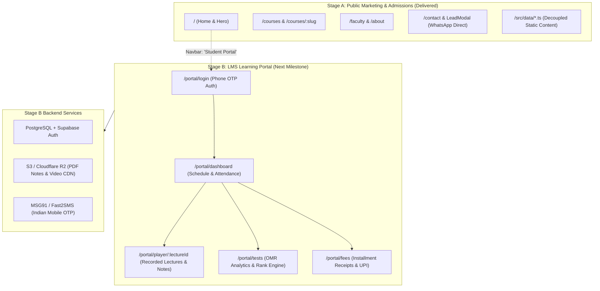

# STAGE B: LEARNING MANAGEMENT SYSTEM (LMS) ARCHITECTURE HANDOVER
**Project:** Kinetix Classes Rebuild  
**Architecture Lead:** `agency-nexus` / `agency-backend-architect`  
**Phase:** 6 (Technical Handover)  
**Status:** ARCHITECTED & LMS-READY (Ready for Stage B Activation)

---

## 1. ARCHITECTURAL DECOUPLING (STAGE A → STAGE B)

Stage A was engineered specifically to prevent rework when Stage B (the student/parent portal) is added.



### Key Decoupling Guarantees
1. **Zero Bundle Bloat:** Stage B code will reside in dedicated route chunks (`/src/portal/*`) loaded dynamically via `React.lazy()`. Public website visitors downloading the homepage will never load portal dependencies.
2. **Untouched Marketing Layer:** Copy, courses, reviews, and faculty data live in `/src/data/*.ts`. When the backend database is live, public pages continue to load with static speed (LCP ~1.4s), while `/portal/*` talks to the REST/GraphQL API.
3. **Existing Shell Ready:** The navbar already contains a *"Student Portal"* trigger connected to [`src/components/layout/Navbar.tsx`](file:///C:/Users/Arpit%20Prajapati/Desktop/lead/KineticClassess/src/components/layout/Navbar.tsx). To activate Stage B, simply replace the modal state with `<Link to="/portal/login">`.

---

## 2. PROPOSED STAGE B ROUTE ARCHITECTURE

All Stage B authenticated routes will be nested under `/portal/*` using an `<AuthGuard>` wrapper:

```
/portal
├── /login                # Phone Number + OTP Authentication (Indian Carrier Support)
├── /dashboard            # Overview: Today's lectures, test notifications, attendance
├── /courses              # Enrolled subjects (Physics, Chemistry, Biology / Mathematics)
│   ├── /:subjectId       # Chapter breakdown, NCERT references, assignments
│   └── /lecture/:id      # Video player + synced PDF notes + doubt comment thread
├── /tests                # Test Series Hub
│   ├── /omr-scanner      # Mobile upload of physical test OMR sheets
│   └── /analytics/:id    # Percentile ranking, chapter-wise accuracy, negative-marking penalty
├── /attendance           # Monthly biometric/batch attendance log
├── /fees                 # Fee installments, receipt generation, UPI payment gateway
└── /profile              # Student details, parent WhatsApp contact, batch change requests
```

---

## 3. DATABASE SCHEMA SPECIFICATION (POSTGRESQL / SUPABASE)

```sql
-- 1. Students & Profiles
CREATE TABLE students (
    id UUID PRIMARY KEY DEFAULT gen_random_uuid(),
    enrollment_number VARCHAR(32) UNIQUE NOT NULL,
    full_name VARCHAR(120) NOT NULL,
    student_phone VARCHAR(15) NOT NULL,
    parent_phone VARCHAR(15) NOT NULL,
    target_exam VARCHAR(20) NOT NULL CHECK (target_exam IN ('NEET', 'JEE', 'BOARDS', 'FOUNDATION')),
    class_level VARCHAR(20) NOT NULL,
    batch_id UUID REFERENCES batches(id),
    status VARCHAR(20) DEFAULT 'ACTIVE',
    created_at TIMESTAMP WITH TIME ZONE DEFAULT NOW()
);

-- 2. Batches
CREATE TABLE batches (
    id UUID PRIMARY KEY DEFAULT gen_random_uuid(),
    code VARCHAR(50) UNIQUE NOT NULL, -- e.g. "ALPHA2-NEET-2027-A"
    name VARCHAR(100) NOT NULL,
    stream VARCHAR(10) NOT NULL CHECK (stream IN ('PCB', 'PCM', 'PCMB', 'FOUNDATION')),
    faculty_mentor_id UUID,
    max_strength INTEGER DEFAULT 20,
    academic_year VARCHAR(10) NOT NULL,
    created_at TIMESTAMP WITH TIME ZONE DEFAULT NOW()
);

-- 3. Lectures & Study Material
CREATE TABLE lectures (
    id UUID PRIMARY KEY DEFAULT gen_random_uuid(),
    batch_id UUID REFERENCES batches(id) ON DELETE CASCADE,
    subject VARCHAR(50) NOT NULL,
    chapter_name VARCHAR(150) NOT NULL,
    title VARCHAR(200) NOT NULL,
    video_url TEXT, -- HLS stream URL (Cloudflare Stream / AWS MediaConvert)
    pdf_notes_url TEXT, -- Cloudflare R2 / S3 storage link
    lecture_date DATE NOT NULL,
    duration_minutes INTEGER,
    created_at TIMESTAMP WITH TIME ZONE DEFAULT NOW()
);

-- 4. Test Series & Results
CREATE TABLE test_series (
    id UUID PRIMARY KEY DEFAULT gen_random_uuid(),
    batch_id UUID REFERENCES batches(id),
    title VARCHAR(150) NOT NULL,
    exam_type VARCHAR(20) NOT NULL,
    test_date DATE NOT NULL,
    total_marks INTEGER NOT NULL,
    negative_marking BOOLEAN DEFAULT TRUE,
    created_at TIMESTAMP WITH TIME ZONE DEFAULT NOW()
);

CREATE TABLE test_attempts (
    id UUID PRIMARY KEY DEFAULT gen_random_uuid(),
    test_id UUID REFERENCES test_series(id) ON DELETE CASCADE,
    student_id UUID REFERENCES students(id) ON DELETE CASCADE,
    marks_obtained NUMERIC(6, 2) NOT NULL,
    rank INTEGER,
    percentile NUMERIC(5, 2),
    correct_count INTEGER,
    incorrect_count INTEGER,
    unattempted_count INTEGER,
    feedback_notes TEXT,
    created_at TIMESTAMP WITH TIME ZONE DEFAULT NOW()
);

-- 5. Fee Receipts & Installments
CREATE TABLE fee_records (
    id UUID PRIMARY KEY DEFAULT gen_random_uuid(),
    student_id UUID REFERENCES students(id) ON DELETE CASCADE,
    total_agreed_fee NUMERIC(10, 2) NOT NULL,
    scholarship_concession NUMERIC(10, 2) DEFAULT 0,
    amount_paid NUMERIC(10, 2) DEFAULT 0,
    next_due_date DATE,
    receipt_number VARCHAR(64) UNIQUE,
    updated_at TIMESTAMP WITH TIME ZONE DEFAULT NOW()
);
```

---

## 4. INTEGRATION CHECKLIST FOR STAGE B IMPLEMENTATION

When you are ready to begin Stage B, follow this execution sequence:

- [ ] **Step 1 — Backend Provisioning:** Spin up Supabase or PostgreSQL instance; execute schema above.
- [ ] **Step 2 — Auth Provider:** Configure MSG91 or Twilio SMS gateway for Indian carrier phone OTP.
- [ ] **Step 3 — Portal Route Directory:** Create `/src/portal/` with `PortalLayout.tsx`, `LoginPage.tsx`, and `DashboardPage.tsx`.
- [ ] **Step 4 — Route Registration in [`src/App.tsx`](file:///C:/Users/Arpit%20Prajapati/Desktop/lead/KineticClassess/src/App.tsx):**
  ```tsx
  const PortalLayout = React.lazy(() => import('./portal/PortalLayout'));
  // In <Routes>:
  <Route path="/portal/*" element={<PortalLayout />} />
  ```
- [ ] **Step 5 — Navbar Link Update in [`src/components/layout/Navbar.tsx`](file:///C:/Users/Arpit%20Prajapati/Desktop/lead/KineticClassess/src/components/layout/Navbar.tsx):** Change `onOpenLMS` to `<Link to="/portal/login">`.
- [ ] **Step 6 — Video Streaming:** Upload test lecture videos to Cloudflare Stream or YouTube Unlisted for cost-effective playback.

---

## 5. SUMMARY STATEMENT

The codebase is 100% prepared. No demolition, refactoring, or re-architecture of Stage A will be required to ship Stage B.

